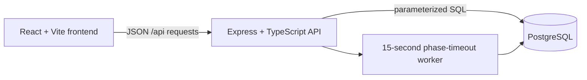

# Architecture

## 1. System Overview

The application is a TypeScript npm-workspace monorepo. The React frontend communicates with a Node/Express API over JSON; the API persists state in PostgreSQL. During local development Vite proxies `/api` requests to Express.



Azure hosting is not implemented yet. The deployment document records a possible future target; there are currently no Azure Functions adapters in the backend.

## 2. Runtime Components

### Frontend

- `frontend/src/pages/` contains the front page (gang-name entry plus admin login), the player lobby/Gameboard, and the admin page.
- `frontend/src/api/` contains typed fetch wrappers; authenticated requests include the `gw_token` cookie.
- `frontend/src/state/` contains the player context (entering and leaving the lobby).
- `frontend/public/characters/` serves the 21 gang portrait PNGs as `/characters/character_NN.png`.
- The open-lobby list refreshes every two seconds. A selected game and its action status also refresh every two seconds. This is polling, not push messaging.
- The active game view groups the player's gang and action controls, shared gang/action history, and Turf ownership into a responsive board.

### Backend

- `backend/src/http/` creates the Express app, authenticates requests, and mounts routes.
- `backend/src/db/` owns the PostgreSQL pool, migrations, transactional persistence, and queries.
- `backend/src/services/` contains game resolution rules and phase-timeout processing.
- `backend/test/` tests pure rules and selected API behavior using Vitest.
- The timeout worker in `backend/src/http/server.ts` checks expired phases every 15 seconds; missing actions are persisted as server-generated `skip` actions and resolved.
- `backend/src/db/pool.ts` loads `backend/.env` relative to its module before constructing the shared pool, so startup does not depend on the shell's working directory.

### Database and game flow

- Games are created by the admin, who is not a game member. Joining is a separate membership operation; it does not create or reuse another player's gang.
- Each member creates one gang named after their player name and selects one of 21 portraits. `(game_id, user_id)` and `(game_id, character_id)` are unique, so a player can have one gang and a portrait can be used only once per game. The database is the final authority if two requests race for the same portrait.
- The admin can start a lobby only with at least two members and one gang per member. Starting creates 20 named neutral Turfs.
- Each round has Phase 1 and Phase 2. Submitted actions remain private until resolution; action status exposes the current player's own submitted action and submission counts.
- Phase resolution runs in a transaction through the persistence adapter and calls a pure service resolver. Results, rolls, and outcomes are stored for the shared Action log.
- Protect applies a `-2` modifier to an incoming contested Expand targeting that gang's Turf in the same Phase 2 resolution.

## 3. Repository Layout

```text
gang-turf-wars/
├── backend/
│   ├── src/db/           # PostgreSQL queries, pool, migrations
│   ├── src/http/         # Express app, routes, auth middleware, server
│   ├── src/models/       # backend model types
│   ├── src/services/     # game rules and timeout worker
│   └── test/             # Vitest tests
├── docs/                 # architecture, rules, API, setup, and roadmap
├── frontend/
│   ├── public/           # banner and gang character portraits
│   └── src/              # React pages, API clients, state, and styles
├── infra/                # reserved for future deployment infrastructure
├── pictures/             # original game artwork
├── shared/               # shared workspace package
├── docker-compose.yml    # local PostgreSQL
└── package.json          # npm workspace scripts
```

## 4. Key Decisions

| Decision | Implementation |
|---|---|
| Keep rules separate from HTTP and persistence | Pure resolution services are called by database adapters; routes validate and dispatch requests. |
| Inject randomness into rules | Tests supply deterministic `randomInt` and `rollDice` functions. |
| Use PostgreSQL with parameterized SQL | Persistence and transaction boundaries live in `backend/src/db/`. |
| Use cookie-based authentication | The API signs JWTs into the httpOnly `gw_token` (player) and `gw_admin_token` (admin) cookies. |
| Poll for multiplayer updates in the MVP | The frontend refreshes lobby/game state every two seconds; no WebSocket service is implemented. |
| Enforce portrait uniqueness in storage | A per-game unique constraint handles concurrent gang creation requests. |

## 5. Authentication and Security

Players have no passwords. Entering a gang name on the front page creates an anonymous users row (the name is unique, case-insensitive) and sets an httpOnly, SameSite=Strict gw_token cookie; player routes validate the JWT and that the player still exists. The admin logs in with the ADMIN_USERNAME/ADMIN_PASSWORD environment variables (compared in constant time; login is disabled until a password is set) and receives a separate gw_admin_token cookie whose JWT carries 
ole: admin. Admin routes under /api/admin accept only that cookie.

- SQL values are passed as parameters.
- Request bodies are validated server-side with Zod.
- Entering the lobby and admin login are rate limited.
- `DATABASE_URL`, `JWT_SECRET`, and `ADMIN_PASSWORD` are loaded from `backend/.env` locally and must be provided through a secret store or deployment settings in production.
- The global delete-games endpoint is admin-only and requires an explicit confirmation value.

## 6. Future Hosting

The current backend is an Express server, not an Azure Functions application. If Azure hosting is pursued, validate the hosting adapter and PostgreSQL connectivity before claiming route parity. See [DEPLOYMENT.md](DEPLOYMENT.md) for the prospective deployment plan.