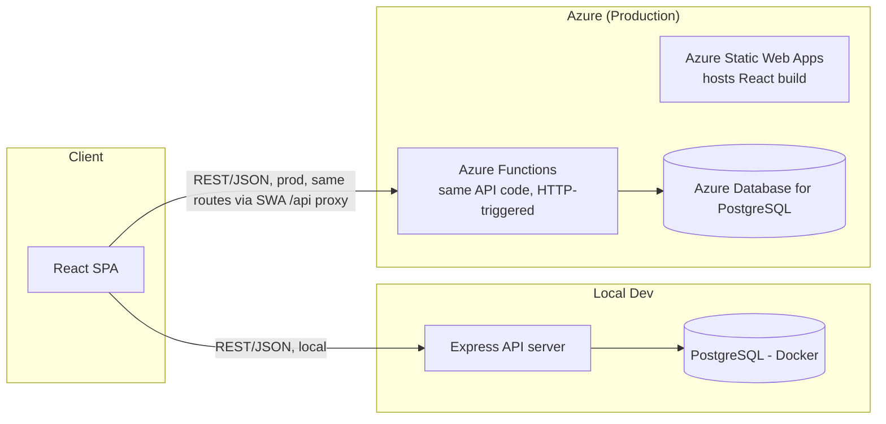

# Architecture

## 1. Overview



The backend is written **once** as a set of route handlers / services and run two ways:
- **Locally**: a plain Express server (`backend/`) for fast iteration, easy debugging, no Azure account needed.
- **In Azure**: the same handlers wrapped as Azure Functions (`backend/functions` or a `swa-cli`-managed `api/` folder) sitting behind Azure Static Web Apps' built-in `/api` routing.

Keeping game logic in framework-agnostic **service modules** (see below) is what makes this dual-run setup possible without duplicating logic.

## 2. Key architectural decisions

| Decision | Reasoning |
|---|---|
| Game rules live in pure, framework-free `services/` modules (no Express/Functions objects touch them) | Same code runs under Express locally and Azure Functions in prod; also makes rules unit-testable in isolation |
| RNG is an injectable dependency (not a direct `Math.random()` call sprinkled through logic) | Enables deterministic unit tests of phase resolution (seeded RNG) |
| Phase resolution is a single pure function: `(gameState, submittedActions) => { newGameState, actionLog }` | Matches the "modular architecture" principle — one well-defined, testable unit instead of tangled per-request logic |
| Auth uses JWT (httpOnly cookie) issued by the backend | Works identically against Express and Azure Functions; no server-side session store needed |
| DB access through a single `db/` module using `pg` (node-postgres) + plain SQL or a lightweight query builder | Keeps a thin, auditable data layer; avoids heavy ORM lock-in while the schema is still evolving |
| Frontend state for "current game" fetched via polling (short interval) for MVP | Simplest option that works with Azure Functions (no persistent WebSocket); can be swapped for Azure SignalR/WebPubSub later without changing game logic |

## 3. Repository layout

```
gang-turf-wars/
├── .github/
│   ├── copilot-instructions.md      # repo-wide AI agent instructions
│   └── workflows/
│       ├── ci.yml                   # lint + unit tests on every PR
│       └── deploy.yml               # build & deploy to Azure Static Web Apps on merge to main
├── docs/                            # this folder
│   ├── GAME_DESIGN.md
│   ├── ARCHITECTURE.md
│   ├── DATA_MODEL.md
│   ├── API_CONTRACT.md
│   ├── ROADMAP.md
│   ├── LOCAL_DEV.md
│   ├── DEPLOYMENT.md
│   └── CONTRIBUTING.md
├── frontend/                        # React app (Vite)
│   ├── src/
│   │   ├── pages/                  # Gameboard, Login, Register, GangCreate
│   │   ├── components/             # small reusable UI pieces
│   │   ├── api/                    # fetch wrappers to backend
│   │   └── state/                  # client-side state (context/store)
│   └── public/
├── backend/
│   ├── src/
│   │   ├── http/                   # Express app + route wiring (local runner)
│   │   ├── functions/              # Azure Functions entry points (thin wrappers calling services/)
│   │   ├── services/               # pure game logic: auth, gang, turf, phase-resolution, rng
│   │   ├── models/                 # typed row/entity shapes
│   │   └── db/                     # connection pool, migrations, queries
│   └── test/                       # unit tests for services/
├── shared/                          # types & constants shared FE/BE (action enums, DTO shapes)
├── infra/                           # Bicep templates for Azure resources (added at deploy milestone)
└── docker-compose.yml               # local Postgres for `LOCAL_DEV.md`
```

## 4. Auth flow (planned)

1. `POST /api/auth/register` — email/username + password (hashed with bcrypt) → creates `users` row.
2. `POST /api/auth/login` — verifies password, issues JWT in an httpOnly, `Secure`, `SameSite=Strict` cookie.
3. Subsequent requests carry the cookie; backend middleware verifies JWT and attaches `userId` to the request.
4. `POST /api/gangs` (create gang) requires auth; one gang per user per game (see Open Questions in GAME_DESIGN.md).

## 5. Security notes (OWASP-aligned, to enforce during implementation)

- Passwords hashed with bcrypt/argon2, never stored/logged in plaintext.
- All SQL via parameterized queries — no string-concatenated SQL.
- JWT secret stored in environment variables / Azure Key Vault or SWA app settings, never committed.
- Input validation on every endpoint (gang name length/charset, action enum whitelist, etc.) both client- and server-side; server-side is the one that matters for security.
- Rate-limit auth endpoints to reduce brute-force risk (even a basic in-memory limiter for MVP).
- CORS locked to the deployed frontend origin in production.
